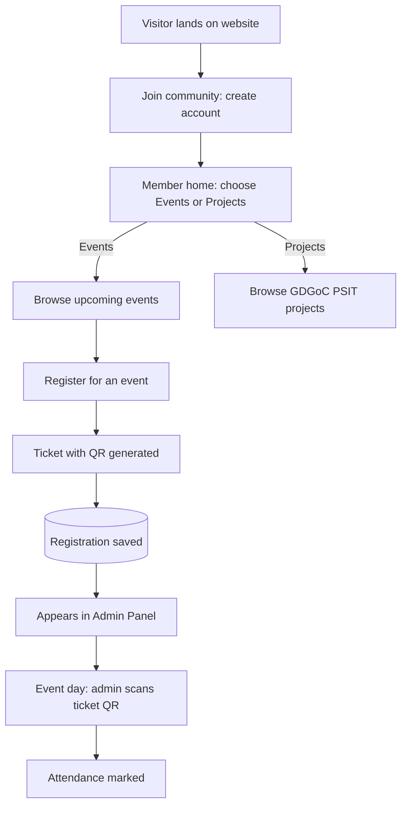

<div align="center">

# 🚀 GDGoC PSIT — Community Platform

**The official website of Google Developer Groups on Campus, PSIT.**
Learn. Build. Connect. Grow — together.


[Live Demo](#) · [Good First Issues](../../issues?q=is%3Aissue+is%3Aopen+label%3A%22good+first+issue%22) · [Report a Bug](../../issues) · [Request a Feature](../../issues)

</div>

---

## 🎃 Open Source October — Contribute with Us

This project is **open source and built by college students, for college students**. We are inviting contributors to build it with us during **Open Source October**, GDGoC PSIT's month-long open-source event.

Whether it's your first pull request or your fiftieth, there's something here for you:

- 🟢 **Beginners** — fix typos, improve docs, tweak styles, add small UI components
- 🟡 **Intermediate** — build pages, wire up APIs, add form validation, write animations
- 🔴 **Advanced** — authentication, QR ticketing, attendance scanner, performance, testing

👉 Jump to [How to Contribute](#-how-to-contribute) to get started in 5 minutes.

> Quality over quantity. Meaningful PRs get merged; spam or low-effort PRs will be marked invalid. See [Contribution Rules](#-contribution-rules).

---

## 📖 About

**GDGoC PSIT** is the student developer community at PSIT, backed by Google Developers. This repository contains the community's official website, where students can discover what we do, explore our projects, register for events, and get a digital ticket for attendance.

A companion **mobile application** is planned (see [What to Build](#-what-to-build)) and will reuse the same backend APIs.

---

## 📌 Project Status

The **Features** section below describes the full plan. This table shows what is actually built today.

| Area | Status | Issue / PR |
|---|---|---|
| Landing page (hero, board, about, events log, domains, crew, join) | ✅ Built | #1, #3 → PR #12, #13 |
| Sign up / log in, sessions, roles | ✅ Built | #4 → PR #10 |
| Profile, account settings, password change | ✅ Built | #9 → PR #11 |
| My Tickets: wallet, ticket page, QR code | ✅ Built | #7 → PR #14 |
| Event listing and registration (creates tickets) | ✅ Built | #6 → PR #15 |
| Member dashboard (events, projects, registrations) | ✅ Built | #5 → PR #16 |
| Admin panel and QR attendance scanner | ✅ Built | #8 → PR #18 |
| Projects showcase page | ✅ Built | #5 → PR #16 |
| Password recovery, refresh tokens, email verification | 🔜 Planned | — |

**Key milestones:** PR #10 (auth) → PR #11 (profile) → PR #12 & #13 (UI & homepage) → PR #14 (tickets) → PR #15 (events) → PR #16 (member dashboard & projects) → PR #18 (admin panel & QR scanner). All core features are merged and verified on `main`.

---

## ✨ Features

### 🌐 Landing Page
A modern, animated, scroll-driven page that tells the community story:

- **Hero** — bold headline, animated Google-colour gradient, floating/parallax elements, primary CTA
- **About** — what GDGoC PSIT is, what we do, and the technologies we use (Flutter, Firebase, Cloud, AI/ML, Android, Web)
- **Events preview** — highlights of upcoming and recent events
- **Projects preview** — featured community-built projects
- **Team** — leads, core team and members with hover/flip cards
- **Join the Community** — call-to-action to create an account

### 🔐 Accounts & Member Home
- Students **sign up / log in** to join the community
- After login, the member lands on their **dashboard**: account summary, upcoming events, their registrations, and the way into Events and Projects

### 🎟️ Events
- Anyone can browse upcoming events (with search and filters); members log in to register
- Event detail view: description, date, venue, speakers, seats left
- **Register directly from the event** — no external forms
- A **ticket with a unique QR code** is generated instantly after registering
- Tickets stay available under **My Tickets**
- Duplicate-registration, deadline and capacity checks built in

### 🧩 Projects
- Dedicated **Projects page** showcasing everything built under GDGoC PSIT
- Cards with description, tech stack tags, contributors, GitHub and live links
- Filter by domain (Web, Mobile, AI/ML, Cloud) and status (Ongoing / Completed)

### 🛡️ Admin Panel (basic dashboard)
- Secure admin login (role-based access)
- **Receives every event registration** as soon as a member registers
- **Scan and mark attendance** — the admin scans a member's ticket QR at the event
- Add and edit events and projects, and **track project status** (Ongoing / Completed)
- Registration and attendance counts per event, with CSV export

### 🎨 UI / UX
- Fully responsive, mobile-first
- Smooth page transitions, scroll-triggered animations, magnetic buttons, custom cursor
- Light and dark themes
- Accessible and SEO-friendly

---

## 🔄 User & Admin Flow



### How Ticketing & Attendance Works

1. A student creates an account and logs in.
2. From the member home, they open **Events** and pick an event.
3. On **Register**, the server checks capacity, deadline and duplicates.
4. A unique `ticketId` is created and encoded into a **QR code**; the ticket is shown under *My Tickets*.
5. The same registration is **instantly visible in the admin panel**.
6. On event day, the admin opens the scanner, scans the ticket, and `attended` is set to `true`. A ticket can only be used once.

---

## 🧰 Tech Stack

| Layer | Technologies |
|---|---|
| **Frontend** | React (Vite), React Router, Tailwind CSS |
| **Animation / Motion** | Framer Motion, GSAP + ScrollTrigger, Lenis (smooth scroll), Lottie, tsParticles |
| **UI Extras** | shadcn/ui, Lucide icons, React Hot Toast |
| **State & Data** | TanStack Query, Zustand, Axios, React Hook Form + Zod |
| **Backend** | Node.js, Express.js |
| **Database** | MongoDB Atlas, Mongoose |
| **Auth** | JWT (access + refresh), bcrypt, role-based middleware |
| **Tickets & Attendance** | `qrcode` (generation), `html5-qrcode` (scanning) |
| **Email** | Nodemailer |
| **Media** | Cloudinary |
| **Deployment** | Vercel (frontend), Render / Railway (backend), MongoDB Atlas |

---

## 📁 Project Structure

```
GDGoC-Community-WEBSITE/
├── src/                         # React 19 + TypeScript frontend
│   ├── components/              # UI components
│   │   ├── intro/               # 3D intro card & loader
│   │   ├── world/               # Three.js 3D DeckWorld scene
│   │   ├── Admin.tsx            # Admin dashboard, event manager & QR scanner
│   │   ├── Dashboard.tsx        # Member area dashboard & registrations
│   │   ├── EventsPage.tsx       # Searchable events catalog & filters
│   │   ├── EventDetail.tsx      # Event info & one-click RSVP
│   │   ├── Tickets.tsx          # Ticket wallet & QR passes
│   │   ├── ProjectsPage.tsx     # Chapter projects showcase
│   │   ├── Profile.tsx          # Account settings & credentials
│   │   ├── Nav.tsx & Footer.tsx # Neo-brutalist navigation & footer
│   │   └── ui.tsx               # Reusable buttons, badges, pills & tags
│   ├── data/                    # Static content, team, and chapter copy
│   ├── lib/                     # Business logic, API client, auth & crypto
│   ├── App.tsx                  # Hash router and page wipe transitions
│   ├── index.css                # Neo-brutalist styling & Tailwind tokens
│   └── main.tsx                 # Client entrypoint
│
├── server/                      # Express 5 + Node.js backend
│   ├── middleware/              # Auth, admin guard, CSRF & rate limiters
│   ├── models/                  # User, Event, Registration schemas
│   ├── routes/                  # /auth, /users, /events, /tickets, /admin
│   ├── utils/                   # Ticket generation, QR encoding & sanitizers
│   ├── seed-admin.js            # Superadmin seeder script
│   ├── seed-events.js           # Sample events seeder script
│   └── index.js                 # API server entrypoint (PORT 5000)
│
├── tests/                       # Vitest component & boundary test suites
│   ├── admin.test.tsx           # Admin panel & QR validation tests
│   ├── dashboard.test.tsx       # Member dashboard & privacy tests
│   ├── events.test.tsx          # Event filtering & RSVP flow tests
│   ├── tickets.test.tsx         # Ticket state & QR tests
│   ├── auth.test.tsx            # Form validation & session tests
│   └── *.test.ts                # Standalone physics & domain checks
│
├── package.json                 # Frontend dependencies & root check scripts
├── vite.config.ts               # Vite bundler & /api proxy configuration
└── README.md
```

---

## 🗃️ Data Models (overview)

| Model | Key fields |
|---|---|
| **User** | name, email, password, role (`student` / `admin`), enrollmentNo, branch, year |
| **Event** | title, summary, description, startsAt, endsAt, venue, poster, category, format, host, prerequisites, capacity, registeredCount, registrationDeadline, meetingUrl, published, cancelled |
| **Registration** | user, event, ticketId (unique), qrData, attended (bool), attendedAt |
| **Project** | title, description, techStack[], contributors[], githubUrl, liveUrl, status, image |
| **TeamMember** | name, role, image, socials, tier (`lead` / `core` / `member`), order |

---

## 🔌 API Endpoints (overview)

| Method | Endpoint | Description | Access |
|---|---|---|---|
| `GET` | `/health` / `/api/health` | Service & MongoDB readiness health check | Public |
| `POST` | `/api/auth/register` | Create a member account | Public |
| `POST` | `/api/auth/login` | Log in and receive session cookie | Public |
| `POST` | `/api/auth/logout` | Clear session cookie | Authenticated |
| `GET` / `PATCH` | `/api/users/me` | Fetch / update authenticated profile | Member |
| `PATCH` | `/api/users/me/password` | Change password (invalidates all other active tokens) | Member |
| `GET` | `/api/events` | List all published events | Public |
| `GET` | `/api/events/:id` | Event details, plus member registration state | Public / Member |
| `POST` | `/api/events/:id/register` | Register for an event and generate ticket with QR | Member |
| `POST` | `/api/events/:id/cancel` | Cancel registration and release seat | Member |
| `GET` | `/api/tickets` | List tickets belonging to the signed-in member | Member |
| `GET` | `/api/tickets/:ticketId` | Fetch ticket with dynamic SVG QR code | Member |
| `GET` | `/api/admin/stats` | Chapter metrics (members, events, registrations, attendance rate) | Admin |
| `GET` | `/api/admin/events` | Full event list including drafts and cancelled events | Admin |
| `POST` | `/api/admin/events` | Create and publish a new event | Admin |
| `PUT` | `/api/admin/events/:id` | Edit event details, capacity, and deadlines | Admin |
| `DELETE` | `/api/admin/events/:id` | Permanently remove an event | Admin |
| `GET` | `/api/admin/events/:id/registrations` | Attendee roster and registration export | Admin |
| `GET` | `/api/admin/users` | List registered community members | Admin |
| `PATCH` | `/api/admin/users/:id/role` | Promote or demote user role (`student` ↔ `admin`) | Admin |
| `POST` | `/api/admin/attendance/scan` | Validate ticket QR code and mark single-use attendance | Admin |

### 🏠 Homepage content

| Content | Source of truth | Notes |
|---|---|---|
| Open Source October dates and status | `src/lib/oso.ts` | Every section (hero card, campaign, About code card, board) reads from here |
| Stats, notices, calendar, events, domains | `src/data/content.ts` | Static for now; move to the API when an admin panel exists (#8) |
| Social links (footer, Join section) | `SOCIAL_LINKS` in `src/data/content.ts` | Only real chapter links; add Discord here once confirmed |
| Crew roster | `src/data/members.ts` | Add each lead here as they are announced; open "this slot could be you" cards fill the rest of the grid |

- **Join form** does not store anything itself: it sends visitors to the real sign-up page (`/#/login?mode=signup`) with name, email and year prefilled.
- **Cards with details** (events, domains) open on hover, keyboard focus or tap.
- **Menu** opens on click, moves focus to the first item and closes with Escape.
- **Reduced motion**: the intro fades instead of animating, marquees stop, letters stay still and the custom cursor is off.
- **Checks**: `npm run check` runs the typecheck, tests and production build.
- **Known limitations**: event photos are stock images until the chapter's own photos are added; the Discord link is pending.
### 🎟️ My Tickets

- **Pages:** `/#/tickets` (ticket wallet with filters) and `/#/tickets/<ticketId>` (one ticket with its QR code). Both need a login; signed-out visitors go to login and come back.
- **Data model:** a `Registration` is the ticket. It links a user and an `Event`, has a random `ticketId` (22 characters, unique), a `status` (`pending`, `confirmed`, `cancelled`) and `attendedAt`. One registration per user per event (unique index).
- **Ownership:** every ticket query filters by the logged-in user. Someone else's ticket, an unknown ID and a malformed ID all return the same `404`, so nothing leaks. Responses never include database IDs or other members' data.
- **States** (worked out on the server; the event-end rule lives in `src/lib/tickets.ts` and is shared by the API and the UI — an event without an end time lasts 24 hours from its start):

  | State | Meaning | QR shown |
  |---|---|---|
  | `confirmed` | Registered and the event hasn't ended | Yes |
  | `pending` | Waiting for confirmation | No |
  | `checked_in` | Attendance recorded (`attendedAt` set) | No |
  | `cancelled` | The registration was cancelled | No |
  | `event_cancelled` | The event itself was cancelled | No |
  | `expired` | The event ended and the ticket wasn't used | No |

- **QR code:** generated on the server as SVG. The payload is only the `ticketId` — no names, emails or tokens. The attendance scanner (#8) looks the ID up and checks the state on the server, so a QR made in the browser can't create a valid ticket.
- **Creating tickets:** done by event registration (#6). For local testing, `cd server && npm run seed:tickets -- you@example.com` adds sample tickets (marked "Sample:") to an existing account.
- **Not built yet:** ticket download as a file and sharing; printing works from the ticket page.

### 📅 Events

- **Pages:** `/#/events` (search, filters and sorting) and `/#/events/<id>` (full details and registration). Anyone can browse; registering needs a login, and signed-out visitors are sent to `/#/login?next=/events/<id>` and brought back.
- **Search:** runs on the already-loaded list, so it makes no extra requests. It ignores case and extra spaces and matches events that contain every word in the title, summary, category or venue.
- **Filters:** Upcoming / Past / All, In person / Online, category (built from the categories that exist) and "Open for registration", plus sorting by date or recently added. They combine, and "Reset search and filters" clears them. Search and filters are kept in the URL (`/#/events?q=cloud&format=online`), so links can be shared and "← All events" returns to the same results.
- **Status** (worked out in `src/lib/events.ts`, shared by the API and the UI, checked in this order):

  | Status | Meaning | Can register |
  |---|---|---|
  | `cancelled` | The organisers cancelled the event | No |
  | `completed` | The event has ended (no end time = 24 hours after the start) | No |
  | `ongoing` | The event has started | No |
  | `full` | Every seat is taken | No |
  | `closed` | The registration deadline has passed (no deadline = the start time) | No |
  | `open` | Accepting registrations | Yes |

- **Drafts:** events have `published: false` until an admin publishes them (#8). Unpublished events never appear in the list, and their links return `404`.
- **Registration** (`POST /api/events/:id/register`):
  - `201` with `{ event, ticket }`: the ticket is the saved registration, so "View your ticket" works straight away.
  - `401` when not logged in, `404` for unknown, malformed or unpublished events.
  - `409` with a plain message when the event is full, closed, started, ended or cancelled, or when you're already registered (that response includes your `ticketId`).
- **Cancelling** (`POST /api/events/:id/cancel`): members can cancel from the event page (with a confirm step) until the event starts. The seat goes back to the pool straight away, the old ticket stops working, and a repeated cancel returns the same `200`. Cancelling after the event has started or after check-in returns `409`; cancelling without a registration returns `404`. Registering again later gives a new ticket ID, so an old printed QR code can't be reused.
- **Meeting links:** an online event can have a `meetingUrl` (must start with `https://`). It is never in the public listing or event details. Only a member with a valid (confirmed) ticket gets it, on the event page and on the ticket page as **Join online meeting**. It disappears once the registration is cancelled or the event has ended.
- **Capacity and races:** a seat is claimed with one atomic database update that only succeeds while the event is open and `registeredCount < capacity`. If saving the registration then fails (for example a double click), the seat is given back. The unique user + event index stops duplicate registrations. The seat count shown on the page is a guide; only a `201` confirms a seat.
- **Time zone:** event times are shown in IST (`Asia/Kolkata`), since every event is at PSIT Kanpur.
- **Responses** never include database internals such as `registeredCount` or other members' registrations.
- **Sample data:** `cd server && npm run seed:events` adds published sample events (marked "Sample:") covering open, nearly full, closed, cancelled, online and past events.
- **Not built yet:** creating and editing events (admin panel, #8).

### 🏠 Member Dashboard

- **Page:** `/#/dashboard` is where members land after logging in or signing up (it is the default `next` for the login page). The nav's account button and the menu link to it once signed in.
- **Access:** the page first calls `GET /api/users/me` and shows only a neutral skeleton until that succeeds, so nothing private flashes on screen. `401` sends the visitor to `/#/login?next=/dashboard`; a network or server error shows "couldn't reach the server" with a retry instead of logging them out. The API protects `/api/users/me` and `/api/tickets` on its own, so editing frontend state can't reveal anything.
- **What it shows** (each card loads, fails and retries on its own; nothing is made up):

  | Section | Data | Empty / error |
  |---|---|---|
  | Welcome | First name from `/api/users/me` | — |
  | Member card + profile status | Name, email, branch, year, member since; upcoming / attended counts from `/api/tickets` (shown as `–` until loaded); prompt to add a missing branch, year or bio | — |
  | Events | Upcoming events from `/api/events` (soonest first, up to 3) and how many there are | "No upcoming events right now" / retry |
  | Projects | Description, link to `/#/projects` and the chapter GitHub | No project data exists yet, so no counts or highlights |
  | Your registrations | Active upcoming tickets from `/api/tickets` (up to 3), linking to each ticket | "You haven't registered…" with a link to events / retry |

- **Member navigation:** Dashboard, Events, Projects, My tickets and Profile tabs (the current page is marked with `aria-current="page"`) plus **Log out**, shown on the dashboard, My tickets and Profile pages. Log out calls `POST /api/auth/logout` (clears the session cookie) and only then goes to the login page; if it fails the member stays signed in and sees an error.
- **Projects page:** `/#/projects` is a placeholder until the projects API exists; it links to the chapter's GitHub instead of showing invented projects.
- **Unknown links:** any `/#/…` route that doesn't exist shows a "Page not found" page with links home, to events and to the dashboard.
- **Not built yet:** announcements on the dashboard (the notice board is still static content, so it isn't repeated here) and project highlights (need the projects API).


- **Pages:** `/#/login` (log in, with a link to sign up) and `/#/login?mode=signup`. Protected pages send signed-out users to `/#/login?next=<page>` and return them there after login.
- **Session:** one JWT (7 days) in an `httpOnly` cookie, so browser scripts never see the token. Locally the cookie is `SameSite=Lax`. With `NODE_ENV=production` it becomes `SameSite=None; Secure`, because the frontend (Vercel) and API (Render) are different sites, and the server trusts the proxy's client IP. CORS only allows `CLIENT_URL`. The app restores the session on reload by calling `GET /api/users/me`.
- **Logout** clears the cookie and returns to `/#/login`. **Changing the password** signs out every other device (`tokenVersion` on the user). An expired or invalid token gets `401`, and protected pages redirect to login.
- **Roles:** `student` (default) and `admin`. Sign-up always creates a `student`, and no API sets a role from the request body. Make an admin directly in the database. The server checks every protected route; the frontend only decides what to show.
- **Errors:** always `{ message, errors? }`, where `errors` maps field names to messages. Internal details are never returned.
- **Abuse protection:** only real authentication failures count — a wrong email or password at login (`401`) and signing up with an email that already exists (`409`). Form validation errors (`400`) never count. Failures are counted per IP **and** per email; 10 failures on either within 15 minutes return `429`, and a successful login clears that email's counter. Counters live in MongoDB (`authfailures` collection, removed automatically by a TTL index), so the limit holds across restarts and across several API instances. Responses also use `nosniff`, `DENY` framing and `no-referrer`.
- **Duplicate sign-ups:** the email is unique in the database. If two sign-ups with the same email race past the "already registered" check, the database rejects the second one and the API returns the same `409 Conflict` instead of a server error.
- **CSRF protection:** the production cookie is `SameSite=None; Secure` because the frontend and API are on different sites, so the API checks every state-changing request (`POST`, `PATCH`, …):
  - with an `Origin` header, it must be exactly `CLIENT_URL` or the API's own origin, otherwise `403`;
  - without `Origin`, a browser-marked cross-site request (`Sec-Fetch-Site: cross-site`) is also `403`;
  - requests with neither header come from non-browser clients, which cannot use a visitor's cookie.

  CORS only allows `CLIENT_URL` with credentials. See **Deployment** for checking this against the live API.
- **Validation** lives in `src/lib/profile.ts` and is shared by the frontend and the server.
- **Tests:**
  - `npm test`: auth page behaviour (validation, password toggle, switching forms, loading, network failure, redirects).
  - `npx tsx tests/profile.test.ts`: shared validation.
  - `cd server && npm test`: ticket lifecycle unit tests, plus API tests for registration (including concurrent duplicate sign-ups), login and wrong credentials, profile updates, password changes (other sessions signed out), expired and forged sessions, logout, role escalation, CSRF, dashboard data protection (missing, forged, expired and stale sessions), tickets, events (listing, drafts, deadlines, cancelled events, capacity races, double clicks, cancelling and registering again, private meeting links) and rate limiting. See **Verification** for running them against a local database.
- **Not built yet:** refresh tokens, password recovery (needs SMTP for time-limited reset links), email verification, and admin-only routes (#8 adds a `403` role check with its first admin endpoint).

---

## 🤝 How to Contribute

### 1. Find something to work on
- Browse [open issues](../../issues). Start with the **`good first issue`** label if you're new.
- Or pick something from [What to Build](#-what-to-build) below and open an issue for it first.

### 2. Claim the issue
Comment **"I'd like to work on this"** on the issue and wait for a maintainer to assign it to you. One person per issue, and please don't work on unassigned issues, as it may lead to duplicate effort.

### 3. Fork, clone and set up
```bash
# Fork the repo on GitHub, then:
git clone https://github.com/<your-username>/gdgoc-psit.git
cd gdgoc-psit
git remote add upstream https://github.com/<org>/gdgoc-psit.git
```
Follow [Local Setup](#️-local-setup) below to run the project.

### 4. Create a branch
```bash
git checkout -b feat/short-description     # or fix/..., docs/..., style/...
```

### 5. Make your changes
- Keep the PR focused: **one issue = one PR**
- Follow the existing folder structure and naming
- Keep components small and reusable
- Make sure it is **responsive** and doesn't break dark/light themes
- Run the linter before committing: `npm run lint`

### 6. Commit using Conventional Commits
```bash
git commit -m "feat: add event search bar"
git commit -m "fix: ticket QR not rendering on Safari"
git commit -m "docs: improve local setup steps"
```
Prefixes: `feat`, `fix`, `docs`, `style`, `refactor`, `test`, `chore`.

### 7. Push and open a Pull Request
```bash
git push origin feat/short-description
```
Open a PR against the `main` branch and:
- Link the issue (`Closes #<issue-number>`)
- Describe what you changed and why
- Add **screenshots or a short screen recording** for any UI change
- Mark the checklist in the PR template

### 8. Review
A maintainer will review your PR. Please respond to feedback promptly. Once approved and merged, it counts as your contribution to Open Source October.

---

## 📏 Contribution Rules

- ✅ One PR per issue, meaningful and tested changes
- ✅ Be respectful and follow the [Code of Conduct](CODE_OF_CONDUCT.md)
- ✅ Write your own code; if you use AI tools, review and understand everything you submit
- ❌ No spam PRs (whitespace changes, trivial README edits made only to get a PR count)
- ❌ No copy-pasted code you can't explain
- ❌ No committing `.env` files, secrets or `node_modules`
- ❌ No unrelated changes bundled into one PR

Low-quality or spam PRs will be labelled `invalid` / `spam` and closed and will not be counted for Open Source October.

---

## 🏷️ Issue Labels

| Label | Meaning |
|---|---|
| `good first issue` | Beginner-friendly, small and well-scoped |
| `help wanted` | Open for anyone to pick up |
| `frontend` / `backend` / `design` / `docs` | Area of the work |
| `bug` | Something isn't working |
| `enhancement` | New feature or improvement |
| `level: easy` / `level: medium` / `level: hard` | Difficulty |
| `open-source-october` | Part of the Open Source October event |
| `oso-accepted` | Merged/approved PR counted for Open Source October |
| `invalid` / `spam` | Won't be accepted |

---

## 🛠️ What to Build

Pick an area, open an issue, and get it assigned.

### 🟢 Easy
- [ ] Improve README and add setup screenshots
- [ ] Footer with social links
- [ ] 404 and error pages
- [ ] Loading skeletons for cards
- [ ] Dark/light theme toggle polish
- [ ] Accessibility fixes (alt text, focus states, ARIA labels)

### 🟡 Medium
- [ ] Animated landing page sections (Hero, About, Events and Projects preview, Join CTA)
- [ ] Team section with hover/flip cards
- [ ] Events page with search and filters
- [ ] Projects page with domain and status filters
- [ ] Form validation with React Hook Form + Zod
- [ ] Responsive navbar with mobile menu
- [ ] Email templates for ticket confirmation

### 🔴 Hard
- [x] Authentication (JWT access, role-based routes)
- [x] Event registration with automatic QR ticket generation
- [x] "My Tickets" page with ticket download
- [x] Admin dashboard: live registrations table, CSV export
- [x] Admin QR scanner that marks attendance (single-use tickets)
- [x] Rate limiting, input sanitisation and security hardening
- [x] Unit and API tests
- [x] CI pipeline (lint + build on every PR)

### 🚀 Stretch goals
- [ ] 📱 Mobile application (React Native / Flutter) using the same APIs
- [ ] Push notifications for event reminders
- [ ] Certificates for attendees
- [ ] Leaderboard and contribution tracking

---

## 👥 Roles, Access Control & Login Guide

The platform implements role-based access control (RBAC) enforced simultaneously on the React hash-router frontend and the Express backend middleware (`requireAuth`, `requireAdmin`).

### Role Permissions Matrix

| Capability | Visitor / Guest | Student / Member (`student`) | Administrator (`admin`) |
|---|:---:|:---:|:---:|
| Explore Landing Page & 3D Interactive World | ✅ | ✅ | ✅ |
| Browse Public Events & Search Catalog | ✅ | ✅ | ✅ |
| View Chapter Projects Showcase (`/#/projects`) | ✅ | ✅ | ✅ |
| RSVP / Register for Events (Generates Ticket QR) | ❌ *(Prompts Login)* | ✅ | ✅ |
| Member Dashboard (`/#/dashboard`) & Registrations | ❌ | ✅ | ✅ |
| Ticket Wallet & Download QR Pass (`/#/tickets`) | ❌ | ✅ | ✅ |
| Profile & Security Management (`/#/profile`) | ❌ | ✅ | ✅ |
| Red `⚡ Admin` Console Badge in Navigation Bar | ❌ | ❌ | ✅ |
| Access Admin Console (`/#/admin`) | ❌ *(Redirects 404)* | ❌ *(Redirects 404)* | ✅ |
| View Realtime Chapter Analytics & Attendance Rate | ❌ | ❌ | ✅ |
| Create, Edit, Publish & Cancel Events | ❌ | ❌ | ✅ |
| View Attendee Rosters & Export CSV Data | ❌ | ❌ | ✅ |
| Promote / Demote Member Roles (`student` ↔ `admin`) | ❌ | ❌ | ✅ |
| Gate Attendance QR Scanner (Camera & Manual Entry) | ❌ | ❌ | ✅ |

---

### How to Log In as Each Role

#### 1. 🛡️ Administrator Role
- **Direct Route**: [`/#/admin`](http://localhost:5173/#/admin) (or click the red `⚡ Admin` button in the top navigation bar when logged in).
- **Default Superadmin Credentials**:
  - **Email**: `admin@gdgoc.dev`
  - **Password**: `Admin1234!`
- **Capabilities**: Full access to chapter statistics, event lifecycle management, member roster table, user role toggle, and the physical event Gate Scanner.
- **How to Create or Promote an Admin**:
  - **CLI Seeder**: In `server/`, run `node --env-file=.env seed-admin.js`. This creates or updates the configured `SUPERADMIN_EMAIL` to role `admin`.
  - **Admin Console UI**: Any logged-in admin can promote an existing member to `admin` with one click in the **User Management** tab at `/#/admin`.
  - **API**: `PATCH /api/admin/users/:id/role` with `{ "role": "admin" }`.

#### 2. 🎓 Student / Member Role
- **Direct Route**: [`/#/dashboard`](http://localhost:5173/#/dashboard) (after login) or [`/#/login`](http://localhost:5173/#/login).
- **How to Create a Member Account**:
  - Open [`/#/login?mode=signup`](http://localhost:5173/#/login?mode=signup).
  - Enter name, college email (`@psit.ac.in` recommended), and password (minimum 8 characters with at least one letter and one number).
  - New accounts default to the `student` role.
- **Capabilities**: Personalized dashboard with greeting, real-time ticket counts, missing profile prompts, one-click event registrations, and the ticket wallet.

#### 3. 🌐 Visitor / Guest Role
- Unauthenticated visitors can browse all public sections (`/#/`, `/#/events`, `/#/projects`).
- Clicking "Register" on an event or clicking the navigation account button automatically redirects to `/#/login?next=/events/:id` so the visitor seamlessly resumes their action upon authentication.

---

## ⚙️ Local Setup & Running Guide

### Prerequisites
- **Node.js**: `v22.18+` (or latest LTS; matching `.nvmrc`). Shared validation code in `src/lib/` is executed natively by Node.
- **npm**: `v10+`
- **MongoDB**: Local MongoDB instance (`mongodb://127.0.0.1:27017/gdgoc_community`) or a MongoDB Atlas connection URI.

---

### Step 1: Start the Backend Server

```bash
cd server
npm install
cp .env.example .env     # or populate your server/.env directly
```

**`server/.env` template:**
```env
PORT=5000
MONGO_URI=mongodb://127.0.0.1:27017/gdgoc_community
JWT_SECRET=super_secret_jwt_gdgoc_official_token_2026_dev_key
CLIENT_URL=http://localhost:5173
NODE_ENV=development
SUPERADMIN_EMAIL=admin@gdgoc.dev
SUPERADMIN_PASSWORD=Admin1234!
SUPERADMIN_NAME=GDGoC Lead Admin
```

#### Seed Initial Data
```bash
# Seed the default superadmin account (admin@gdgoc.dev / Admin1234!)
node --env-file=.env seed-admin.js

# Seed sample events (workshops, study jams, watch parties)
node --env-file=.env seed-events.js
```

#### Run the API Server
```bash
npm run dev
```
*The API starts on **`http://localhost:5000`** with health check at **`http://localhost:5000/health`**.*

---

### Step 2: Start the Frontend Client

In a new terminal window at the **root of the repository** (do not `cd client`):

```bash
# Install frontend dependencies
npm install

# Start Vite dev server with Hot Module Replacement
npm run dev
```
*The frontend opens at **`http://localhost:5173`** (or `http://localhost:5174` if 5173 is occupied). Vite automatically proxies all `/api/*` network requests to `http://localhost:5000`.*

---

### Repository Scripts

| Location | Command | Purpose |
|---|---|---|
| **repo root** | `npm run dev` | Start Vite dev server with proxy to backend |
| **repo root** | `npm run build` | Production bundle with `vite-plugin-singlefile` inlining |
| **repo root** | `npm test` | Run all 7 frontend Vitest test suites |
| **repo root** | `npm run test:scripts` | Standalone validation scripts: `profile`, `oso`, `ruru`, `statuscard` |
| **repo root** | `npm run check` | **Full CI pipeline**: Typecheck + Vitest + Standalone tests + Build |
| **`server/`** | `npm run dev` | Start API server with auto-restart on changes |
| **`server/`** | `npm start` | Start API server in production mode |
| **`server/`** | `npm test` | Run backend test suite (31 unit & integration tests) |
| **`server/`** | `node --env-file=.env seed-admin.js` | Seed or update superadmin account |
| **`server/`** | `node --env-file=.env seed-events.js` | Seed sample events into database |

---

## 🛠️ Developer Guide: What to Know Before Changing Anything

Before making any pull request or architectural modification, review these non-negotiable conventions:

### 1. Hash Routing
The application uses a lightweight, hash-driven SPA router (`location.hash`) for zero-configuration compatibility across static hosting providers (GitHub Pages, Vercel, Netlify).
- Route dictionary is defined in `src/App.tsx` (`pages` object).
- Whenever creating a new page or modal view, declare its hash route in `src/App.tsx` and ensure navigation links use `#/route` format (e.g., `#/dashboard`, `#/projects`).

### 2. Single Source of Truth
Never duplicate core business definitions or status calculation:
- **Campaign dates & Open Source October math**: Defined solely in `src/lib/oso.ts`. Do not hardcode campaign dates elsewhere.
- **Copy & Static Cards**: Defined in `src/data/content.ts` (domains, pillars, notices, and past event archive).
- **Shared Validation**: Files in `src/lib/` (such as `profile.ts` and `events.ts`) are shared directly between the TypeScript frontend and the Node.js backend. Keep them pure, portable, and standard-library compliant.

### 3. Authentication & Session Lifecycles
- Auth tokens are issued as HTTP-only, secure, `SameSite=None` session cookies.
- **Token Versioning**: Every User record contains a `tokenVersion: number`. Changing passwords immediately increments `tokenVersion`, invalidating active JWT tokens across all sessions and devices.
- **CSRF & Origin Protection**: All state-modifying requests (`POST`, `PUT`, `PATCH`, `DELETE`) verify the HTTP `Origin` header against `CLIENT_URL` (in production) or allowed local ports (in development).

### 4. Ticket & QR State Machine
A ticket moves through strictly defined states in `src/lib/tickets.ts` and `server/utils/tickets.js`:
- `pending` ➔ `confirmed` ➔ `checked_in`
- Terminal states: `cancelled`, `event_cancelled`, `expired`.
- Tickets are cryptographically unique (`ticketId`) and generated on the server. The gate scanner enforces that **each ticket can only be admitted once**. Duplicate admissions are rejected.

### 5. Design System: Neo-Brutalist Aesthetic
GDGoC PSIT uses a distinct neo-brutalist visual style. Always follow existing CSS utility tokens:
- **Borders & Outlines**: Hard 2px or 3px ink borders (`border-[3px] border-ink`).
- **Buttons**: Use `.hard-button` with box shadows (`shadow-[4px_4px_0_var(--color-ink)]`).
- **Brand Colors**: Use curated semantic tokens:
  - `gblue` (`#4285F4`) · `gred` (`#EA4335`) · `gyellow` (`#FBBC04`) · `ggreen` (`#34A853`)
- **Accessibility & Motion**: Respect `prefers-reduced-motion` queries. Background 3D effects (`DeckWorld`, `Ruru`) gracefully step down on mobile or low-power devices.

### 6. Pre-Flight Verification Checklist
Before committing any changes or opening a pull request, run:
```bash
# In repo root:
npm run check

# In server/:
npm test
```
Both commands must pass with **0 errors, 0 warnings, and 0 failing tests**.

---

### Deployment

| Setting | Frontend (Vercel) | API (Render) |
|---|---|---|
| Node.js | 22.18+ (`.nvmrc`) | 22.18+ (`.nvmrc` / `engines`) |
| Environment | `VITE_API_URL=https://<api-host>/api` | `NODE_ENV=production`, `MONGO_URI`, `JWT_SECRET` (long random string), `CLIENT_URL=https://<frontend-host>` (exact origin, no trailing slash) |

The API refuses to start if `MONGO_URI` or `JWT_SECRET` is missing. With `NODE_ENV=production` it trusts the platform proxy for client IPs and sets the session cookie as `HttpOnly; Secure; SameSite=None`.

Check the deployed API after each release:

```bash
API=https://<api-host>/api
FRONTEND=https://<frontend-host>

# allowed: the real frontend origin
curl -s -o /dev/null -w "%{http_code}\n" -X POST -H "Origin: $FRONTEND" $API/auth/logout     # 200
# blocked: any other origin
curl -s -o /dev/null -w "%{http_code}\n" -X POST -H "Origin: https://evil.example" $API/auth/logout   # 403
# CORS preflight answers only the real frontend, with credentials
curl -s -D - -o /dev/null -X OPTIONS -H "Origin: $FRONTEND" -H "Access-Control-Request-Method: POST" $API/auth/login | grep -i access-control
```

---

## 💬 Need Help?

- Ask questions in the issue you're working on
- Use [GitHub Discussions](../../discussions) for general questions and ideas
- Check existing issues before opening a new one

---

## 📄 License

Distributed under the MIT License. See [`LICENSE`](LICENSE) for details.

---

<div align="center">

**Made by students, for students.** 🌱
Google Developer Groups on Campus · PSIT

⭐ Star the repo if you like it, and happy contributing this Open Source October! 🎃

</div>